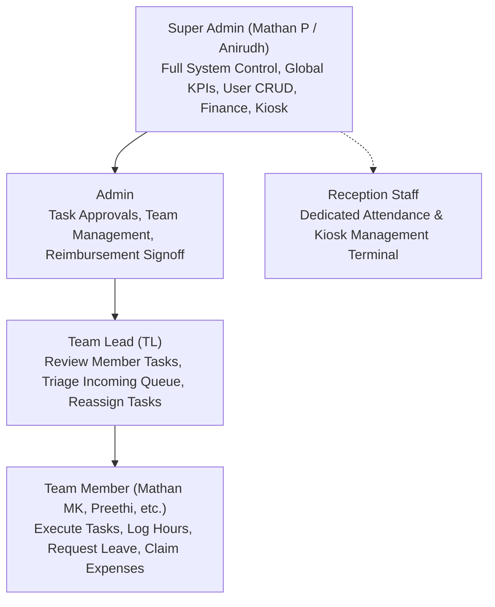

# 🚀 TaskFlow SaaS — Comprehensive Project Overview & Technical Audit

> **Target Application:** TaskFlow Production Internal Task & Workforce Management Platform  
> **Repository:** `c:\Users\NTC\AntiGravity\Ambizcon_Project`  
> **Production URL:** [https://taskflow-saas-app-five.vercel.app](https://taskflow-saas-app-five.vercel.app)  
> **Author & Lead Engineer:** Mathan P (Super Admin / AI PM)  
> **Audit Date:** October 15, 2026  
> **Document Version:** 2.0.0 (Production Verified)

---

## 1. Executive Summary

**TaskFlow** is an enterprise-grade, internal Operations, Task Management, and Workforce Operations platform tailored for multi-departmental corporate environments. Designed to replace fragmented tooling (Trello, Slack chat threads, Excel attendance registers, physical bill receipts, and disconnected Google sheets), TaskFlow consolidates the day-to-day operational lifecycle across **Creative**, **Marketing**, and **Development** teams into a unified SaaS portal.

The application is deployed on **Vercel** with a serverless architecture powered by **Next.js 15 (App Router)**, **React 19**, and a cloud database built on **Supabase PostgreSQL**. It features complete multi-tenant role-based access control (**Super Admin**, **Admin**, **Team Lead**, **Team Member**, and **Reception Staff**), cross-team request pipelines, dynamic QR kiosk attendance tracking, reimbursement claim workflows with receipt inspection, team presence muster consoles, and a real-time team chat engine.

---

## 2. Business Problem & Solution Matrix

| Corporate Pain Point | How TaskFlow Solves It | Implemented Module |
|---|---|---|
| **Disorganized Task Delegation** | Visual Kanban with drag-and-drop, 11 Quick Start task templates with pre-populated checklists, priority badges, and estimated hours. | [`features/kanban/KanbanBoard.tsx`](file:///c:/Users/NTC/AntiGravity/Ambizcon_Project/features/kanban/KanbanBoard.tsx), [`features/tasks/TaskCreateModal.tsx`](file:///c:/Users/NTC/AntiGravity/Ambizcon_Project/features/tasks/TaskCreateModal.tsx) |
| **Siloed Cross-Team Requests** | Cross-team incoming queue. When Marketing needs design collateral from Creative, tasks route to an incoming triage queue for TL approval before hitting the board. | [`features/incoming/IncomingQueue.tsx`](file:///c:/Users/NTC/AntiGravity/Ambizcon_Project/features/incoming/IncomingQueue.tsx), [`app/(dashboard)/incoming/page.tsx`](file:///c:/Users/NTC/AntiGravity/Ambizcon_Project/app/%28dashboard%29/incoming/page.tsx) |
| **Accountability & Review Footprints** | Two-tiered review approval workflow. Members cannot mark tasks "Done"; they must submit to a Team Lead for review with an immutable footprint log. | [`features/tasks/TaskDetailModal.tsx`](file:///c:/Users/NTC/AntiGravity/Ambizcon_Project/features/tasks/TaskDetailModal.tsx) |
| **Attendance & Buddy Punching** | Dynamic rotating QR Code Kiosk refreshed every 15 seconds, strict photo-less GPS/IP kiosk guard, automated break timers, and nightly midnight auto-clockouts. | [`components/attendance/DynamicQrKioskModal.tsx`](file:///c:/Users/NTC/AntiGravity/Ambizcon_Project/components/attendance/DynamicQrKioskModal.tsx), [`app/api/attendance/`](file:///c:/Users/NTC/AntiGravity/Ambizcon_Project/app/api/attendance/) |
| **Financial Claims & Lost Receipts** | Full reimbursement claim workflow. Pre-approval claim editing, multi-receipt attachments with inline zoom inspection, and admin approval/rejection notes. | [`app/(dashboard)/reimbursements/page.tsx`](file:///c:/Users/NTC/AntiGravity/Ambizcon_Project/app/%28dashboard%29/reimbursements/page.tsx) |
| **Notification Fatigue** | Scoped notifications. When a member completes a task, only Super Admin, Team Lead, and that specific member are notified; all other members are shielded. | [`lib/notification-filter.ts`](file:///c:/Users/NTC/AntiGravity/Ambizcon_Project/lib/notification-filter.ts), [`store/useNotificationStore.ts`](file:///c:/Users/NTC/AntiGravity/Ambizcon_Project/store/useNotificationStore.ts) |
| **Multi-Company Operations** | Seamless entity switching between **Ambizcon Health - India** and **Ambizcon Australia** with strict data filtering across team presence and leave balances. | [`store/useCompanyStore.ts`](file:///c:/Users/NTC/AntiGravity/Ambizcon_Project/store/useCompanyStore.ts), [`lib/company-filter.ts`](file:///c:/Users/NTC/AntiGravity/Ambizcon_Project/lib/company-filter.ts) |

---

## 3. Target Users & User Roles

The platform defines 5 authoritative roles with strict client and server permission gating:



1. **Super Admin**: Highest privilege (Mathan P, Anirudh). Has access to executive KPI reporting, finance/salary administration, team presence muster consoles, festival leave quotas, and global user management.
2. **Admin**: Operational management. Approves reimbursement claims, reviews team tasks, and manages departmental settings.
3. **Team Lead (TL)**: Departmental supervisor. Evaluates member work, requests changes with review notes, approves tasks to "Done", triages incoming cross-team tasks, and monitors team presence.
4. **Team Member**: Individual contributor. Views team tasks, changes status to "Review", logs standard and overtime hours, submits reimbursement claims with attachments, and manages personal self-reminders.
5. **Reception Staff**: Specialized kiosk operator. Restricted UI with access solely to Attendance & Kiosk for office clock-in/out scanning.

---

## 4. High-Level Folder Structure

```
c:\Users\NTC\AntiGravity\Ambizcon_Project\
├── actions/                  # Next.js Server Actions ('use server')
│   ├── analyticsActions.ts   # Analytics aggregations & KPIs
│   ├── attendanceActions.ts  # Punch clock, QR tokens, break tracking
│   ├── commentActions.ts     # Task discussion threads
│   ├── reimbursementActions.ts # Expense claim submissions & approvals
│   ├── taskActions.ts        # Task CRUD, review workflows, status changes
│   └── userActions.ts        # User lookup, session hydration, CRUD
├── app/                      # Next.js 15 App Router
│   ├── (auth)/login/         # AI-themed login & 1-click persona switcher
│   ├── (dashboard)/          # Authenticated dashboard views
│   │   ├── analytics/        # Velocity, SLA pass rate, team output charts
│   │   ├── attendance/       # Clock-in/out, monthly summary, leave quotas
│   │   ├── dashboard/        # Executive overview, presence panel, work tracker
│   │   ├── finance/          # Salary records, emergency contacts, banking
│   │   ├── incoming/         # Cross-team incoming request triage console
│   │   ├── kanban/           # Core Bizzy Board, List View, Calendar View
│   │   ├── profile/          # Employee profile, skills, work mode, DOB
│   │   ├── reimbursements/   # Claims ledger, receipt inspection, approval modal
│   │   ├── reminders/        # Departmental recurrence & client reminders
│   │   ├── reports/          # My Report, Team Report, Company Report (CSV/XLSX)
│   │   ├── self-reminders/   # Personal recurring reminder checklist
│   │   ├── settings/         # System preferences & notification controls
│   │   └── users/            # Super Admin team member CRUD management
│   ├── api/                  # RESTful API endpoints & serverless handlers
│   │   ├── admin/attendance/ # Admin attendance adjustments
│   │   ├── attendance/       # Clock-in, clock-out, QR scan/token, breaks
│   │   ├── auth/me/          # Current session verification
│   │   ├── chat/             # Chat messaging REST fallback
│   │   ├── reimbursements/   # Claim submission endpoint
│   │   └── seed/             # Database initialization endpoint
│   ├── chat/                 # Real-time team & DM chat console
│   ├── globals.css           # Tailwind custom tokens, glassmorphism, animations
│   └── layout.tsx            # Root layout, theme provider, global notification listener
├── components/               # Modular UI & Feature Components
│   ├── attendance/           # QR Kiosk Modal, Scanner, Festival Leaves Panel
│   ├── dashboard/            # Hourly Work Tracker, Team Presence Overview
│   ├── layout/               # Header, Sidebar, Global Search (Cmd+K), Shortcuts
│   ├── tasks/                # Reviewer Select Modal, Task Edit, Completed Explorer
│   └── ui/                   # Button, Card, Modal, Input, Badge, Skeleton, Avatar
├── features/                 # Domain-Specific Feature Modules
│   ├── analytics/            # Recharts velocity and status charts
│   ├── dashboard/            # Dashboard widgets and KPI cards
│   ├── incoming/             # Cross-team routing tables and action bars
│   ├── kanban/               # Drag-and-drop Kanban Board, List & Calendar views
│   ├── reports/              # Scoped report tables and export generators
│   ├── tasks/                # TaskCard, TaskCreateModal, TaskDetailModal
│   └── users/                # User management data table
├── lib/                      # Core Utilities, Services & Adapters
│   ├── attendance-db.ts      # Attendance state engine and punch calculators
│   ├── audio-chime.ts        # Synthesized Web Audio API sound alerts
│   ├── avatar-store.ts       # DiceBear & custom photo upload avatar resolver
│   ├── chat-db.ts            # Local chat message persistence & channel logic
│   ├── client-db.ts          # Client organizations and medical center records
│   ├── company-filter.ts     # Multi-entity filtering (India vs. Australia)
│   ├── db.ts                 # Database connection export (Supabase client)
│   ├── notification-filter.ts# Strict role & member notification delivery rules
│   ├── seed-data.ts          # Seed task templates, personas, repetitive tasks
│   ├── self-reminders-store.ts# Supabase self-reminders sync
│   ├── supabase.ts           # Supabase client initialization
│   └── work-logs-store.ts    # Hourly work slot tracking
├── store/                    # Zustand Global Client State Stores
│   ├── useAuthStore.ts       # Current user session and auth persistence
│   ├── useCompanyStore.ts    # Active company entity switcher
│   ├── useNotificationStore.ts # Centralized notification queue & popups
│   ├── useSearchStore.ts     # Global search query and filter state
│   └── useTaskStore.ts       # Task cache and selected modal state
├── supabase/migrations/      # Version-controlled idempotent SQL migrations
│   ├── 20261012000001_taskflow_unified_supabase_schema.sql
│   ├── 20261012000002_festival_leaves_and_balances.sql
│   ├── 20261012000003_self_reminders.sql
│   └── 20261012000004_work_logs.sql
└── types/                    # End-to-end TypeScript definitions
    ├── database.ts           # Supabase auto-generated table typings
    └── index.ts              # Domain models (Task, User, Leave, Claim, Chat)
```

---

## 5. Implementation Status Audit

| Module / Feature | Code Location | Status | Verification Evidence |
|---|---|---|---|
| **Kanban Bizzy Board** | `features/kanban/KanbanBoard.tsx` | **Completed & Verified** | Drag-and-drop between To Do, In Progress, Review, Support, Done. Role-gated move rules verified in production. |
| **List & Calendar Views** | `features/kanban/TaskListView.tsx`, `TaskCalendarView.tsx` | **Completed & Verified** | Full view mode switching with search, priority badges, and date cell task counts. |
| **Task Creation & 11 Templates** | `features/tasks/TaskCreateModal.tsx`, `lib/seed-data.ts` | **Completed & Verified** | 11 Quick Start team templates auto-populate checklists, hours, and department. Standardized button "Create Task". |
| **TL Review Footprint Workflow** | `features/tasks/TaskDetailModal.tsx` | **Completed & Verified** | TL/Admin review approval with audit footprint log. "Request Changes" returns tasks with custom feedback notes. |
| **Scoped Notification Targeting** | `lib/notification-filter.ts`, `store/useNotificationStore.ts` | **Completed & Verified** | Strict delivery rule: task completions notify Admin, TL, and that member only. Other members receive no popups or chimes. |
| **Reimbursement Claims & Pre-Approval Edit** | `app/(dashboard)/reimbursements/page.tsx` | **Completed & Verified** | Claim submission, editing while "Pending", bill file upload, receipt zoom inspection, and admin status management. |
| **Dynamic QR Kiosk & Punch Clock** | `components/attendance/DynamicQrKioskModal.tsx`, `QrScannerModal.tsx` | **Completed & Verified** | 15s rotating token generation, HTML5 camera QR scan, break tracking, and automated midnight reset. |
| **Team Presence & Hourly Work Tracker** | `components/dashboard/TeamPresenceOverviewPanel.tsx`, `HourlyWorkTrackerPanel.tsx` | **Completed & Verified** | Live muster table, hourly slot logging, overtime indicators, and Australia vs. India team filter. |
| **Festival Leaves & Admin Balances** | `components/attendance/FestivalAndLeaveAdminPanel.tsx` | **Completed & Verified** | Common festival leave list, casual/sick/earned leave balances, admin quota adjustment. |
| **Cross-Team Incoming Queue** | `features/incoming/IncomingQueue.tsx` | **Completed & Verified** | Cross-team task raising, triage approval by target team lead, and priority routing. |
| **Team Chat & Direct Messaging** | `app/chat/page.tsx`, `lib/chat-db.ts` | **Completed & Verified** | Group channel messaging, 1-on-1 direct messaging, unread badges, and attachment support. |
| **Multi-Tiered Reports & CSV Export** | `features/reports/ReportsView.tsx` | **Completed & Verified** | My Report, Team Report, and Company Report with client-side CSV & XLSX data export. |
| **Global Command Palette & Hotkeys** | `components/layout/GlobalSearchModal.tsx`, `KeyboardShortcutsModal.tsx` | **Completed & Verified** | `Cmd+K` / `Ctrl+K` global task and member search, keyboard shortcut cheat sheet (`?`). |
| **Supabase Unified Database** | `supabase/migrations/`, `lib/supabase.ts` | **Completed & Verified** | 13 PostgreSQL tables with indexes, RLS policies, and serverless client connection. |
| **Automated Test Suite** | `tests/phase1.test.ts` | **Partially Implemented** | Contains legacy role tests from early scaffold; modern end-to-end unit tests for TaskFlow modules need expansion. |

---

## 6. Key Metrics Summary

- **Total Source Files:** 119 files
- **Total Lines of Code:** 36,555 lines
- **App Router Pages:** 16 pages
- **API Serverless Endpoints:** 14 endpoints
- **Server Actions:** 6 action suites (Task, User, Attendance, Reimbursement, Comment, Analytics)
- **Database Tables:** 13 tables (Supabase PostgreSQL)
- **Production Build:** Next.js 15.5.22, 100% clean compilation, 0 TypeScript errors
- **Current Live Production Deployment:** [https://taskflow-saas-app-five.vercel.app](https://taskflow-saas-app-five.vercel.app)
