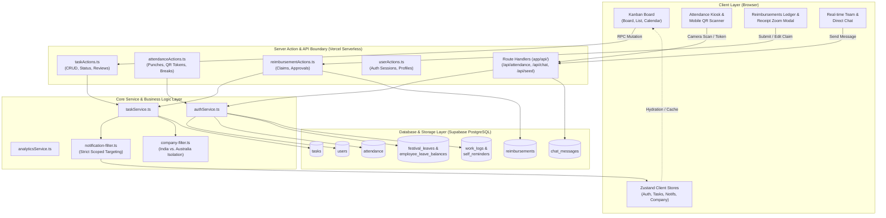
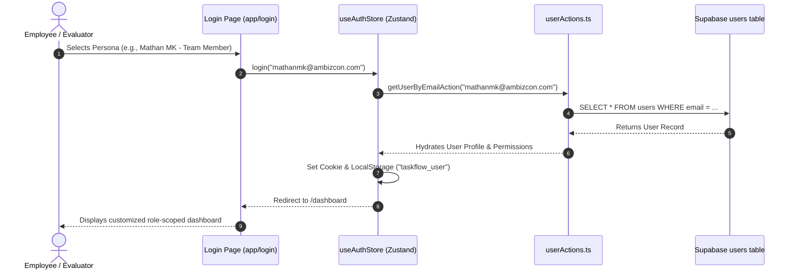
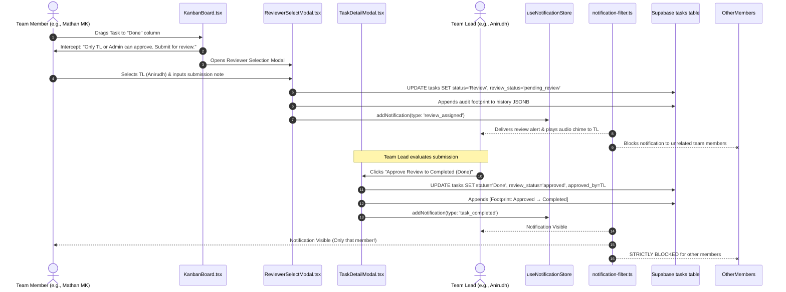
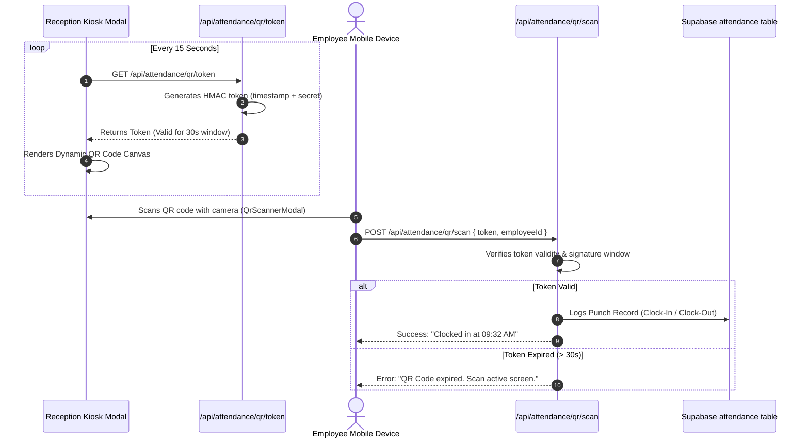
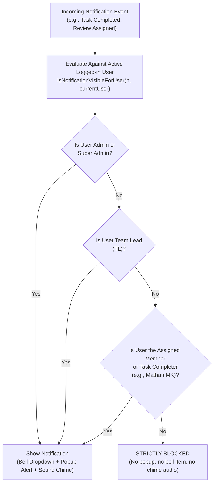
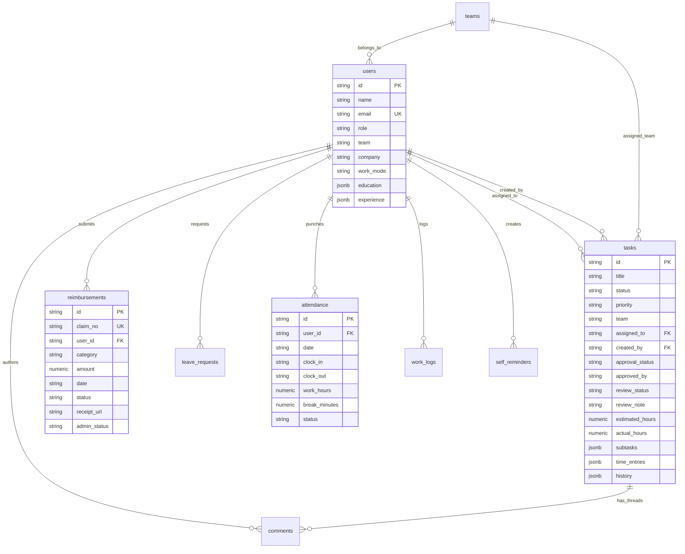

# 🏛️ TaskFlow SaaS — System Architecture & Data Flow

> **Document Version:** 2.0.0  
> **Status:** Production Verified  
> **Last Updated:** October 15, 2026

---

## 1. High-Level Architecture Overview

TaskFlow utilizes a modern serverless three-tier architecture built around the Next.js 15 App Router paradigm. Rather than traditional heavyweight REST API layers, the application leverages **React Server Actions** for direct, type-safe Remote Procedure Call (RPC) data mutations, coupled with **Supabase PostgreSQL** for persistent relational storage.

---

## 2. Authentication & Persona Switching Flow

The authentication system supports standard credentials alongside a 1-click **Persona Switcher** for technical evaluation and management audits:

---

## 3. Two-Tiered Task Review & Approval Workflow

TaskFlow implements an audit footprint workflow preventing Team Members from self-approving tasks to completed:

---

## 4. Attendance QR Kiosk & Rotating Token Architecture

To eliminate proxy clock-ins ("buddy punching"), TaskFlow generates ephemeral cryptographic tokens:

---

## 5. Scoped Notification Filtering Architecture

TaskFlow ensures notifications are delivered exclusively to authorized parties, solving the "notification fatigue" problem:

---

## 6. Entity Relationship Diagram (ERD)

