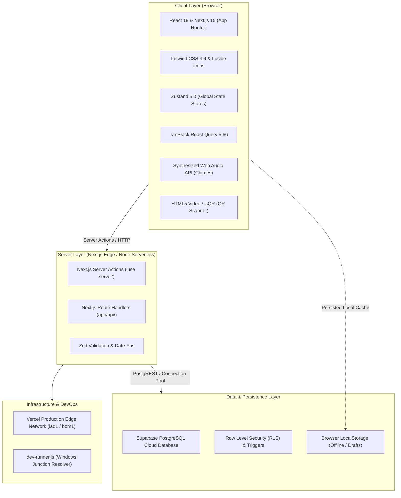

# 🛠️ TaskFlow SaaS — Comprehensive Technology Stack

> **Document Version:** 2.0.0  
> **Status:** Production Verified  
> **Last Updated:** October 15, 2026

---

## 1. Overview of Technology Stack

TaskFlow is constructed using a high-performance, modern full-stack TypeScript architecture optimized for low-latency serverless execution, responsive desktop/mobile usability, and strong database consistency.

---

## 2. Frontend Technologies

| Category | Technology | Version | Purpose & Usage in Codebase |
|---|---|---|---|
| **Core Framework** | **Next.js (App Router)** | `15.1.7` / `15.5.22` | Server-rendered pages, hybrid SSG/SSR, and unified API boundaries. Used across all routes in `app/`. |
| **UI Library** | **React** | `19.0.0` | Concurrent rendering, hooks (`useCallback`, `useMemo`, `useEffect`), and modern React Server Component paradigms. |
| **Type System** | **TypeScript** | `5.7.3` | End-to-end type safety covering database schemas, Server Action contracts, component props, and API payloads. |
| **Styling Engine** | **Tailwind CSS** | `3.4.17` | Utility-first CSS with custom glassmorphism panels, gradients (`ambizcon-gradient`), and dark mode tokens. Configured in `tailwind.config.js` and `globals.css`. |
| **Animation Library** | **Framer Motion** | `12.4.7` | Smooth modal transitions, drag-and-drop feedback, notification slide-ins, and tab switching animations. |
| **Iconography** | **Lucide React** | `0.475.0` | Crisp vector icons utilized across navigation bars, task status chips, modal triggers, and action buttons. |
| **State Management** | **Zustand** | `5.0.3` | Lightweight atomic stores with localStorage persistence: `useAuthStore`, `useTaskStore`, `useNotificationStore`, `useCompanyStore`, `useSearchStore`. |
| **Data Fetching & Cache** | **TanStack React Query** | `5.66.0` | Declarative client-side caching, background invalidation, and optimistic state synchronization. |
| **Chart Visualizations** | **Recharts** | `2.15.1` | Responsive SVG analytics charts for team velocity, task completion burn-downs, and SLA pass rates in `features/analytics/AnalyticsCharts.tsx`. |
| **Toast Notifications** | **Sonner** | `2.0.1` | Non-blocking, beautiful toast alerts for action confirmations, errors, and review state updates. |
| **QR Code Processing** | **jsQR** | `1.4.0` | Client-side pure JavaScript QR scanner decoding camera video frames in real time inside `components/attendance/QrScannerModal.tsx`. |
| **CSV / File Parsing** | **PapaParse** | `5.5.2` | Client-side CSV generation and parsing for report exports in `features/reports/ReportsView.tsx`. |
| **Theme Management** | **next-themes** | `0.4.4` | Dark mode and light mode switching without layout shift. |
| **Audio Synthesis** | **Web Audio API** | *Native Browser API* | Zero-dependency client-side audio chime synthesis in `lib/audio-chime.ts` for task alerts, reminders, and chat pings. |

---

## 3. Backend Technologies

| Category | Technology | Usage in Codebase |
|---|---|---|
| **Runtime Environment** | **Node.js (LTS 20.x / 24.x)** | High-throughput JavaScript runtime supporting serverless execution on Vercel. |
| **API Architecture** | **Server Actions + Route Handlers** | Dual-model architecture: Server Actions (`actions/`) handle mutations and form submissions; Route Handlers (`app/api/`) handle REST integrations and attendance kiosk sync. |
| **Validation** | **Zod (`^3.24.2`)** | Schema validation for user inputs, claim amounts, date parsing, and payload integrity. |
| **Date Manipulation** | **Date-fns (`^4.1.0`)** | Timezone formatting (Asia/Kolkata), working hours calculation, break timers, and relative timestamps ("Just now", "2 hrs ago"). |
| **Session & Auth Guard** | **Cookie & LocalStorage Auth** | Domain-validated authentication (`@ambizcon.com`) with role-based route middleware and persona state hydration. |
| **Development Tooling** | **`dev-runner.js`** | Custom Node.js supervisor script bypassing Windows junction folder symlink conflicts (`AntiGravity` junction path) to keep local server stable on port 3000. |

---

## 4. Database Architecture (Supabase PostgreSQL)

| Component | Specification | Description |
|---|---|---|
| **Database Engine** | **PostgreSQL 15+** | Cloud-hosted relational database via Supabase with ACID transactions and JSONB support. |
| **Connection Client** | `@supabase/supabase-js` (`^2.117.0`) | Official JavaScript SDK connecting server actions and client components to Supabase. |
| **SSR Adapter** | `@supabase/ssr` (`^0.12.7`) | Server-Side Rendering authentication and cookie storage adapter for Next.js App Router. |
| **Migrations** | Version-Controlled SQL | Idempotent migrations stored in `supabase/migrations/`: unified schema, festival leaves, self-reminders, and work logs. |
| **Security Layer** | Row Level Security (RLS) | Enabled across public tables (`festival_leaves`, `employee_leave_balances`, `self_reminders`, `work_logs`). |
| **Performance Indexes** | B-Tree Indexes | Indexes on high-frequency query columns: `tasks(team)`, `tasks(status)`, `tasks(assigned_to)`, `users(email)`, `reimbursements(user_id)`. |

---

## 5. Third-Party Integrations & External Services

| Service / API | Integration Purpose | Location in Codebase |
|---|---|---|
| **Supabase Cloud** | Primary PostgreSQL storage, authentication client, and database connection pooling. | `lib/supabase.ts`, `lib/db.ts` |
| **DiceBear Avatars API** | Dynamic SVG avatar generation based on employee name seeds (`https://api.dicebear.com/7.x/avataaars/svg?seed=...`). | `lib/seed-data.ts`, `lib/avatar-store.ts` |
| **Unsplash CDN** | High-definition professional profile and header images loaded with optimized lazy loading. | `components/dashboard/TeamPresenceOverviewPanel.tsx` |
| **Vercel Edge Platform** | Production continuous deployment, DNS routing, serverless function orchestration, and SSL termination. | `https://taskflow-saas-app-five.vercel.app` |

---

## 6. Deployment & Build Configuration

- **Next.js Config:** `next.config.mjs` configured with `serverActions: true` and strict image domain whitelisting (`api.dicebear.com`, `images.unsplash.com`).
- **Build Output:** Static pre-rendered HTML (`○`) for 34 routes + Dynamic Serverless Functions (`ƒ`) for authenticated API routes.
- **Production Bundle:** Shared First Load JS of `102 kB` (Chunks: `1255-cf02c4775860a5ab.js` [46 kB], `4bd1b696-100b9d70ed4e49c1.js` [54.2 kB]).
